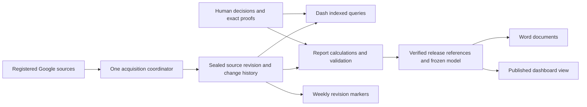

# Architecture

Last broad overview: 2026-06-04. Source/storage paths below rechecked: 2026-10-12 (Kamchatka).

## Уточнение цели 16.10.2026

Архитектура должна локализовать изменения. Адаптер нового источника не
переписывает математику, новый показатель не требует смены хранилища, новый
экран не копирует расчёт. Технические версии обеспечивают воспроизводимость;
это не параллельные продукты. Единственный план и приёмка остаются в
[PLAN](PLAN.md) и [#69](https://github.com/gaben1488/dash/issues/69).

18.10: [рабочий реестр перехода](PLAN.md#consolidated-mandate) связывает
142 подзадачи с прежними результатами #69, всеми13страницами, T001–T158 и обоими
наборами предложений владельца. Начальная редакция17.10 содержала134работы;
после сверки прежних требований уточнены8участков. У каждой — основание,
зависимости, приоритет исполнения и проверяемый итог;
пилоты БД/server-state не являются принятыми заменами стека. Реестр не означает,
что все142задачи реализованы или что исходники полностью проаудированы.

### Фоновое исполнение — уточнение18.10.2026

Сохраняется существующий `report-worker`: отдельный Python-процесс в том же
server image и на том же VPS. Он последовательно выполняет `run_once`, затем
ждёт `REPORT_POLL_SECONDS` (по умолчанию900секунд **после завершения** прохода).
`runtime.py` владеет lock/capture/reuse/build/recheck/publication, `worker.py` —
циклом, остановкой и существующим weekly/retention обслуживанием. Второй
универсальный worker, новый VPS или Redis/Celery не являются требованием.

Node/API пока имеет собственные source refresh/снимки; Python самостоятельно
читает источники отчёта. Общая папка ещё не делает их единым согласованным
входом. R05.01/C08.02/R08.01 должны согласовать наблюдения, правила, admission
и публикацию, сохранив существующие предметные проверки. Не добавляется второй
набор таймеров. Обычный GET читает готовый результат; незавершённое обновление
не требует держать запрос открытым. Синхронная обработка в Node и конкуренция
за общий CPU/диск остаются измеряемыми ограничениями даже при отдельном worker.
Нет принятого состояния — явная первоначальная загрузка; сбой источника —
последнее пригодное состояние с его фактической давностью. Новый worker не
является способом исправить повторное полное хеширование bundle в GET.

### Независимая декомпозиция целевого продукта — 18.10.2026

<a id="target-decomposition"></a>

Владелец отдельно разрешил переписывание, рефакторинг и миграцию. Ограничение
«только узкие заплатки» не является целью. Замена выбирается по дефекту,
радиусу изменения, ресурсам и проверяемому результату; это разрешение на код,
а не на изменение живых книг, необратимое удаление или обход условий выпуска.

### R01.01 — центральные дома корзин и правил (кандидат 22.10.2026)

В коде разделены **понятие**, **правило**, **счёт** и **представление**.
Один предикат не делает равными числа, полученные в разные моменты или
при разных годах/фильтрах: сравнение требует source, asOf, coverage и периметр.

| Что менять | Канонический источник | Где используется / проверяется |
|---|---|---|
| ID, имя, механизм, БЗ и предикат двух корзин Реестра | `packages/shared/src/registry-buckets.ts` | `registry-buckets.test.ts`, сервер `routes/registry-buckets.ts`, страницы `DataBrowser.tsx`, `Header.tsx`, API-тип |
| Отсутствующий год плана | `packages/core/src/pipeline/signals.ts`, паспорт `packages/shared/src/check-registry.ts` | `unfunded` читает готовый `planYearMissing`, не считает новое условие |
| ЕП «в течение года», виды и разметка | `packages/shared/src/yearlong-stage.ts` | `yearlong` вызывает `isYearlongStageRow` по сырой колонке Q, не ISO |
| Названия сигналов, метрики, пороги, ГРБС | `product-dictionary.ts`, `metrics/registry.ts`, `threshold-registry.ts`, `department-registry.ts` в `packages/shared/src` | существующие потребители web/core/server, без зеркал |
| Полные числа навигации | `packages/server/src/routes/registry-buckets.ts` | один ответ API: источник, время и покрытие 8 книг; отсутствие — 503, не ноль |
| Числа текущей таблицы с фильтрами | `packages/web/src/pages/DataBrowser.tsx` | тот же предикат, иной явно описанный периметр; не подменять полным числом |

**Стадия:** изолированный рефакторинг определений. Он не закрывает всю R01.01:
56 результатов, 142 работы, связи T001–T158 и доказательства установки/приёмки
сохраняются в едином `docs/PLAN.md`. Изменение ветки, зелёный CI и эксплуатационный
выпуск различаются; P0 #119, worker, backup/restore, три Word, source и браузерные
гейты остаются самостоятельными. Google Sheets и действующее состояние не менялись.

**Два основания одной программы.** Группировка требований отвечает «что нам
обещано». Независимая декомпозиция отвечает «какие способности и состояния
нужны, чтобы Dash решал работу человека от начала до конца». Её нельзя вывести
только из количества прежних задач, названий страниц или семи технических
слоёв. Ниже сначала определены результаты по рабочим сценариям и текущим
исполняемым путям; их сверка со всеми142задачами находится в
[PLAN](PLAN.md#target-reconciliation). D01–D16 — адреса этой модели,
**не второй backlog**. Задачи, приоритеты и статусы остаются прежними.

#### Что действительно прослежено в исходниках

Основание — код `f53785795d9803e339c57b4af1928864ad0ff9e4`, чтение18.10
по Камчатке. Это проверка перечисленных функций и их связей, не заявление
о полном аудите всех файлов или нового наблюдения production.

| Исполняемый путь / первичный код | Наблюдаемая граница и следствие для перехода |
|---|---|
| [app.ts](../packages/server/src/app.ts): `createApp`, `preloadData` → `refreshAllSources` → `getSnapshot` | Маршруты, source refresh, Thursday cron, comments/integrity sweeps и webhook recovery уже существуют. Общий координатор должен принять эти входы; второй независимый набор расписаний не нужен. |
| [snapshot.ts](../packages/server/src/services/snapshot.ts): `getSnapshot`, `createSnapshot`, `saveSnapshot` | Кэш разделён по году, есть serial materialization и stale/refreshing; persist=false уже вызывает ошибку. Сохраняются полный JSON, metric history и строки-проекции. Общий CAS ещё не заменил этот путь. |
| [orchestrator.ts](../packages/core/src/pipeline/orchestrator.ts): `runPipeline` | Нормализация официальных ячеек, построчные сигналы, CalcEngine, дельты и trust соединены в одном проходе. Это пригодное ядро, но его вход ещё содержит сетки/REPORT_MAP и не является общей моделью всех потребителей. |
| [rows-read.ts](../packages/server/src/services/rows-read.ts): `readDeptRows` | Cache → непустое зеркало → master; свежесть зеркала этим путём не доказана. Новый адаптер должен локализовать этот каскад и статус резерва. |
| [rows.ts](../packages/server/src/routes/rows.ts): одиночная и пакетная запись; [row-revision.ts](../packages/server/src/services/row-revision.ts) | Уже есть expected revision, локальный lock, intent и readback. Статические формульные колонки не защищают фактическую формулу в другом столбце; локальный lock не исключает внешнего Google-редактора. Нужна законченная команда, а не второй прямой write из нового UI. |
| [issue-decisions.ts](../packages/server/src/services/issue-decisions.ts): `overlayPersistedStatus`, `withPersistedDecisions`; [issues.ts](../packages/server/src/routes/issues.ts) | Решения хранятся отдельно и накладываются на снимок; rebind требует доказательства и может читать историю. Нельзя объявить всё уже общим ControlCase либо удалить историческую проверку ради ускорения. |
| [schema.ts](../packages/server/src/db/schema.ts), [event-bus.ts](../packages/server/src/services/event-bus.ts) | Есть snapshots/metric_history/procurement_rows, issues/history, audit, comment observations и changelog. SSE — память процесса, seq с нуля, ring100. Ни наличие таблиц, ни ring не доказывают общий durable change stream. |
| [runtime.py](../packages/report-engine/src/procurement_engine/runtime.py): `run_once` → capture → identity → build → final recheck → publish | Python самостоятельно читает Google, ledger, identity reviews и weekly baseline. Переход должен сохранить эти существенные зависимости и fail-closed публикацию, а не заменить их одним хешем значений. |
| [snapshot.py](../packages/report-engine/src/procurement_engine/snapshot.py): `_snapshot_id`; [publication_store.py](../packages/report-engine/src/procurement_engine/publication_store.py): `publish` | ID расчётного снимка включает provider revision; publish сохраняет фактически наблюдённые revisions и scoped equivalence proof. Разделение observation/reuse должно сохранить исходные receipt и исторические IDs. |
| [App.tsx](../packages/web/src/App.tsx), [store.ts](../packages/web/src/store.ts): `fetchDashboard`, `refresh`, `quickRefresh` | 13 разделов, общий store, отдельные запросы и защита от поздних ответов уже есть. Контекст чтения и инвалидация должны проходить через них; перенос бизнес-расчёта в новый экран неприемлем. |
| [TableEditor.tsx](../packages/web/src/components/TableEditor.tsx) → [DataBrowser.tsx](../packages/web/src/pages/DataBrowser.tsx) → [RowDetailCard.tsx](../packages/web/src/components/RowDetailCard.tsx) → [CellNotesMetadata.tsx](../packages/web/src/components/provenance/CellNotesMetadata.tsx) | Есть черновики, сохранение, паспорт и чтение notes выбранной ячейки. Это не полный Google-подобный редактор формул/форматов/threads; развитие сохраняет ввод, адрес и версии. |
| [core registry](../packages/core/src/metrics/registry.ts) → [web wrapper](../packages/web/src/lib/metrics-registry.ts) | Подсказки метрик уже переиспользуются. Каталог описаний не равен исполняемому определению расчёта и графу зависимостей. Не создавать ещё одну копию KB при переходе. |

Полное понимание достигается по участкам: до изменения ответственный читает
весь затрагиваемый путь, всех вызывающих, схемы/миграции, jobs и динамические
entrypoints; фиксирует неясное и отрицательные сценарии в существующих задачах.
Инвентаризированное, прочитанное, воспроизведённое и проверенное на реальных
данных различаются. Исторические190находок, весь Apps Script, все сочетания
прав и полный UX13разделов этой таблицей не закрыты — R01.03/R01.04 остаются.

#### Декомпозиция от результата, а не от списка просьб

| Адрес | Законченная способность Dash | Контракт, владелец состояния и условие готовности |
|---|---|---|
| D01 | Получить пригодные факты и назвать точку, к которой они относятся | Source profiles → ограниченное приобретение → observation set/manifest: состав, actual revisions, интервалы, полнота, зависимости. Один прикладной координатор принимает webhook/cron/request, адаптеры владеют внешними адресами. TS и Python читают один sealed input; неполное чтение не становится полным выпуском. |
| D02 | Узнать закупочный объект после перемещения и показать его связи | Наблюдаемые строки → системная identity и доказанные need/plan/procedure family+attempt/contract/execution/organization links. Репозиторий identity владеет соответствиями/решениями; похожесть текста — предложение, не merge. Перенос/renumber/split/merge/reuse проверяются с сохранением решений и кратности. |
| D03 | Показать, что изменилось, и восстановить нужный срез экономно | Raw/canonical content + observations + typed diffs + checkpoints → воспроизводимая версия. Хранилище владеет объектами/ссылками; недельный маркер ссылается на пригодный четверг. Повторное чтение сохраняет новый факт наблюдения без тяжёлой копии; восстановление и GC ограничены графом ссылок. |
| D04 | Получить одно объяснимое число во всех представлениях | Canonical facts + immutable calculation context → metric results и evidence. Предметное ядро владеет определением/единицами/grain/периодом/применимостью; UI/Word только представляют. Независимый пересчёт и все фильтры сходятся; изменение правила пересчитывает нужный результат. |
| D05 | Пройти от сигнала до подтверждённого полезного действия | Finding + entity + rule evidence → ControlCase → версия решения → effective state/KPI/следующий выпуск. Дело и решение принадлежат прикладной операции, не странице. False positive не штрафует где-либо ещё; закрытие дела не выдумывает исправление первички. |
| D06 | Обсудить работу и расследовать изменение | Evidence/events + Google notes/threads + Dash discussions/decisions → продуктовая лента и metadata строки/ячейки. Discussion/thread state отделён от cell history и ControlCase. Известны источник, было/стало и основание связи; неизвестные автор/время события не сочиняются. Повторные witnesses не удваивают событие/сумму. |
| D07 | Безопасно исправить данные и проверить, что сохранено | Command с target identity/address, expected version, actor, idempotency → intent → external outcome/readback → reconcile → invalidation. Владелец — одна command service для API/batch/Undo/forms. Формулы/итоги защищены на сервере; lost ACK, partial batch и внешний конкурент не превращаются в ложный успех. |
| D08 | Прочитать выбранный контекст без гонок и тяжёлой пересборки | Context-bound query → индексированная read model/summary/detail/cursor → общий client server-state. Прикладное чтение не запускает импорт синхронно; scope/version/access проверяются на каждой границе. Поздний ответ не заменяет новый фильтр, черновик остаётся у клиента. |
| D09 | Принимать предметные решения во всех13разделах | Те же metric/case/entity queries → специализированные рабочие экраны, сравнения и сценарии. Раздел владеет компоновкой/действием, не формулой. От числа можно дойти до причин и действия; различаются планирование, факт, подтверждённая экономия и прогноз. Каждая страница имеет desktop/touch сценарий с readback. |
| D10 | Выпустить и выбрать согласованный комплект документов | Frozen facts+rules+decisions+templates+baseline → ReportModel → main/supplement/operational → immutable receipt. Publication service владеет accepted release, attempt — только исполнением. Экран/история/3Word выбирают один выпуск; recheck, reuse, отказ и историческая совместимость доказаны. |
| D11 | Работать красиво и удобно через общие компоненты | Typed view data + interaction states → production components/Design Lab/мобильная компоновка. UI-система владеет токенами, доступностью, движением и состоянием взаимодействия. Сохранены одобренная геометрия и характер13Зарь; preview использует тот же компонент, mobile завершает те же действия без hover. |
| D12 | Ограничить действия и доказать авторство | Проверенная session/service identity → role/org/action policy → query/command/export. Сервер владеет полномочием; «ответственный» не становится авторизацией. Отзыв доступа, чужая организация, неизвестная среда и массовое действие проверяются отрицательно. |
| D13 | Автоматически довести операцию до конечного результата | Durable job/lease/fencing + admission + delivery checkpoint → bounded execution/recovery/resync. Один владелец операции; event доступен после commit. Crash/restart/дубликат/разрыв SSE не теряет работу и не создаёт второй бизнес-результат. |
| D14 | Работать быстро и экономно, объяснить отказ и безопасно обслужиться | Correlated stage timings/resource inventory/reference graph → budgets/diagnosis/guarded maintenance. Инженер эксплуатации владеет политикой ресурсов, не скрывает domain failure retry. Cold/warm/concurrent замерены отдельно; GC не задевает защищённые ссылки, четыре ops-метрики имеют один источник. |
| D15 | Обновить систему и действительно восстановить прежнюю | Candidate passport/code+data compatibility → checkpoint → isolated restore → install → bounded acceptance/rollback. Один контроллер владеет переходом; прежний reader способен читать откатные данные. Исходный SHA, image digest, schema/rules и proof связываются без приписывания старой приёмки новой версии. |
| D16 | Изменять продукт локально и проверять результат независимо | Требование + исполненный путь + замер → bounded change → oracle/regression → cutover/removal/proof. Интегратор владеет связностью. Изменение адаптера, правила и представления проверяется отдельно; временный мост имеет условие удаления, старый путь перестаёт быть активным владельцем. |

Эти способности пересекают слои намеренно: «настроить таблицу» не завершено,
пока её команда не подтверждена источником и зависимые показатели не обновлены.
У каждого состояния ровно один владелец записи; общие определения и чтения
могут иметь несколько потребителей. D01–D16 не означают16сервисов, новых БД,
пакетов или релизов. Текущие shared/core/server/web и Python сохраняются,
пока границу нельзя провести в них с приемлемой ценой сопровождения.

#### Минимальная модель состояний и причин пересчёта

Разделить существующие смешанные понятия до смены физической схемы:

- **Observation** — факт чтения, источник/профиль/actual revision/время/полнота;
  **content object** — неизменное содержимое; **canonical revision** — смысловое
  представление с версией нормализации. Их ID не являются identity закупки.
- **Entity и address binding** — объект и доказанное соответствие физическому
  адресу на момент чтения. Номер/год/хеш строки не заменяет это соответствие.
- **Calculation context/result** — manifest, normalization/rules/calendar,
  decisions, scope/access и зависимости; **read model** — индексируемая проекция
  этого результата. Она восстанавливается, а не становится новым master.
- **Case/decision/discussion** — разные изменяемые предметные состояния;
  **command/attempt/job** — факт выполнения; **release** — принятый неизменный
  результат. Повтор job не создаёт второе решение, новое наблюдение не теряется.

| Изменение | Что обновляется | Что обязано сохраниться |
|---|---|---|
| Только provider revision; scoped values/formulas/geometry/dependencies эквивалентны | Новое observation и proof; reuse допускается по полному ключу зависимостей | Фактическая revision, raw evidence, прежний receipt; запрет выдать expected token за observed |
| Значимые values/formulas/schema/dependency | Canonical revision, entity changes/diffs и затронутые результаты/read models | Исходник обеих сторон, реальные structural diagnostics; fail-closed при недоказанной пригодности |
| Оформление без предметного смысла | Editor/style projection; новый факт наблюдения при чтении | Форматы доступны редактору, но hidden/index/colors не создают ложный денежный drift |
| Rules/normalization/calendar/template | Соответствующая canonical/result/document revision | Старые raw hashes/IDs и воспроизводимость прежнего правила, без переписи истории |
| Решение/ответ/закрытие | Версия дела/обсуждения, effective signals/KPI и зависимый новый выпуск | Первичные данные и исходная версия решения; Google resolved не закрывает Dash case |
| Filter/access scope | Разрешённая query projection, cache/cursor key | Проверка доступа на сервере; чужие данные не возвращаются из общего кэша |

Смысловая эквивалентность определяется профилем, а не универсальным удалением
метаданных: значимые named ranges/геометрия/ссылки остаются в доказательстве.
Граф зависимостей нужен и для selective recompute, и для объяснения результата,
и для reference-aware GC. Дифы не заменяют все полные объекты: checkpoints и
предел стоимости восстановления выбираются по замеру рабочего объёма.
Полная историческая перезапись ради нового формата запрещена.

#### Переход и граница понимания

Сначала ограниченная вертикаль официальной экономии: source profile/manifest
→ canonical facts → AD-gated calculation → API/Экономия/3Word → readback.
На том же входе проходят shadow comparison и независимый oracle; затем одна
точка переключения потребителей, сохранённый совместимый rollback и отключение
старого активного расчёта этой вертикали. Далее этот путь расширяется на
identity/изменения, дела/журнал, команды/редактор и остальные показатели/страницы.
Целевая модель не блокирует согласованный Header-релиз всей миграцией.

Перед переносом каждого участка в PLAN добавляются точные изменяемые файлы,
вход/выход, characterization/negative tests, состояния записи при переходе,
условие остановки, чтение прежних данных и удаляемый старый вызов. Нельзя заранее
выдумать интерфейс всей системы без проверки конкретного участка. Неясность
фиксируется с проверкой, способной изменить решение, а не словом «enterprise».

Выбран путь модульного монолита с существующим Word-worker. Ближайшая поставка
и переход к общему входу разделены в [ADR-001](decisions/0001-verified-report-publication.md).
Общий вход ещё не внедрён: TypeScript Dash и Python worker сейчас получают
источники независимо. Совпадение проекции одного ReportModel не доказывает
совпадение всех live-экранов с ним.

Уточнение владельца18.10 по повторяющимся сбоям: один сохраняемый планировщик
принимает ручную команду, расписание, webhook и recovery; API читает готовые
версии и состояния. Принятые данные и документы имеют разные pointer/стадии,
с первым переходом обязательны durable job/lease/fencing, проверка покрытия
присоединяемой операции и восстановление после restart. Тяжёлые расчёт/запись,
render и обслуживание ограничиваются отдельно. Существующий TS core можно
вызывать из фонового исполнителя; появление Node worker_thread вb24 —
частичный шаг изоляции CPU, не реализация общей сохраняемой очереди.
Подробное решение и границы доказательства — [ADR-001](decisions/0001-verified-report-publication.md#update-loop-20261018).

| Логическая граница | Существующее размещение | Условие целевого перехода |
|---|---|---|
| Первичные источники | server Google services; report-engine Google adapter | Один состав/профиль/ревизия приобретения; буквы колонок остаются на границе |
| Нормализация, валидация, происхождение | core ingestion; Python raw pipeline и source proof | Одна текущая типизированная модель; история через ограниченные adapters |
| Сущности, связи, история | identity store, procurement rows, expert decisions | Потребность/план/процедура/контракт/исполнение не сплющены; похожесть не identity |
| Правила и показатели | shared/core; report-engine rules и independent audit | Общие определения, единицы, период и зависимости; сравнение на одном input |
| Прикладные операции | Fastify routes, worker, publication store | Явные ACK/readback/idempotency и конечные состояния; отказ выпуска не restart API |
| BI, документы, компоненты | 13 web-разделов, Design Lab, DOCX renderer | Один компонент/селектор для preview и production; Word и BI на одном контексте |
| Хранение и эксплуатация | SQLite, source bundles, reader leases, deploy/systemd | Содержимое по отпечатку отдельно от наблюдений; restore/rollback/GC по ссылкам |

Таблица задаёт границы перехода, а не утверждает, что все они уже реализованы.
PostgreSQL остаётся отдельным решением C08: сначала замеры запросов, конкуренции,
пикового scratch и восстановления. Текущие source-read timeout и повторное
сохранение больших JSON не доказывают ограничение SQLite. Новые брокеры,
микросервисы и дополнительные базы без измеренной необходимости не вводятся.

Повторное чтение, одинаковые байты и идентичность закупки учитываются отдельно.
Наблюдение хранит фактическую provider revision, время/полноту/профиль и ссылку
на содержимое. Переиспользование результата зависит также от правил,
нормализации, календаря, шаблона и доступа. Авторство не выводится из времени
импорта. При исчезновении строки сравниваются пригодный live и последний
подтверждённый четверг Asia/Kamchatka, с сохранением обеих точек и неопределённости.

Существующая граница пока объединяет два разных ключа: `_snapshot_id` в
`report-engine/snapshot.py` включает provider revision вместе с content hash.
На действительной функции с одинаковыми synthetic content/rules/template
смена только revision даёт другой ID. Это подтверждает зависимость текущего
переиспользования от технической ревизии, а не объём лишних live-вычислений.
Исторические ID и доказательства менять нельзя. Общий вход должен отдельно
хранить идентичность наблюдения и ключ переиспользования вычисления со всеми
существенными профилями, правилами, календарём, шаблоном и доступом. Это
условие следующего перехода, не реализованная новая модель хранения.

### Проверяемый ближайший переход, 16.10.2026

Уточнение 21:30 UTC: установлен Bae73c20 (release38961726925), новый и прежний
runtime прошли два независимых восстановления; API/Word/13 разделов в
Chromium и WebKit прошли. Observer38961801554 принял два новых цикла с двойной host FLOCK и native
context/snapshot/3Word после каждого;1638 sealed неизменны, history0invalid.
Новый reader сохранил оба selectors, но повторно не хеширует один и тот же
receipt/files внутри GET. Измерение38968602253 на живом API: 1,518 с native,
два разбора модели 0,813 с, одна inventory 0,207 с; HTTP38968752151 на том же
контексте — 1,690 / 1,641 с. Это прогретые, а не cold измерения; причина
browser21,262 с не установлена. По этим данным нельзя обосновать смену SQLite.

Provenance теперь сохраняет оригинальную книгу, физическую строку журнала и
факт чтения каждого свидетеля. Неоднозначные повторы не складываются в
подтверждённый денежный итог; исходные неизвестные стороны остаются видимыми.
Живой sample38966956109 проверил восемь книг / пять свидетелей, но не встретил
multi-source/overlap. Это законченный ограниченный участок вход→модель→API→UI,
не весь модуль комментариев, не человеческое решение и не официальная экономия.
Перестройка общего acquisition/расчётного контекста остаётся отдельной вертикалью.

Установленный b96 (`4f630e74` / `0d155e1d`) локализует сохранение повторного
attempt и полное чтение evidence в runtime/publication store: наблюдение хранит
hash-ссылку на исходный опубликованный payload, глобальный status остаётся полным.
Это не новая acquisition-модель и не изменение identity/расчётов. Подмена ссылки,
compaction/finalize и restore проверяются на той же границе. До первой публикации
inline-отказ доступен без создания состояния; существующие каталог/fence требуют
lease. `32e9ad6e` задаёт отдельную границу владения: native child read-only GET
завершается при disconnect, принятые POST продолжаются. Release38975748581
установил b96 в22:59UTC после двух restore; observer38978975046 принял два
собственных цикла с точным восстановлением обеих retained-assurance ссылок;
metadata38982529550 подтвердил по4083 logical /4096 allocated B на попытку.
Глобальный status остался полным, старые данные не удалялись.
Chromium38978982855 и
WebKit38978992935 прошли13разделов/Header/3journal/3Word, не весь UX;
результаты и измерения до/после находятся в PLAN и ADR-001/0012.

Установленный d402 (`c0e96be4`) проводит уже существующие Python-наблюдения
генератора через общий typed contract и hook в один React-компонент, без
нового polling, хранилища и дублирования расчётов. Четыре определения находятся
в существующем каталоге метрик. Desktop38985868522 сверил четыре значения
действующего UI с тем же GET. Worker38984598658 принял два новых цикла;
общий вход TS/Python и полная мобильная приёмка этим не доказываются.

Предшествующие основания и измерения:
[ADR0012](decisions/0012-bounded-dashboard-read-model.md) отделяет обычное HTTP
чтение готовой модели от импорта. `ccbd4213` реализует background materialization,
строгий scope, исходное время и явную freshness. Bfd625fc добавил частичный
индекс по времени/ID для weekly-кандидатов, чтобы отсутствие нужного года не требовало разбора
JSON всей истории. Это не общий канонический вход и не доказательство полной
миграции. Предыдущий19289667 принят в своих install/restore/двухциклах/браузере.
Текущийbfd625fc установлен release38949403808: restore/API/3Word PASS19:25UTC,
новые два цикла observer38949805075 PASS,1638sealed неизменны. Индекс установлен; первое journal HTTP в
закрытой установочной приёмке4.617с (startup-log), повторные2.714/3.285с и
4Header15с PASS. Это не host-cold benchmark. Mobile13страниц/3Word PASS;
desktop full repeat PASS с selectedGET19587ms, ранний CHECKING30с сохранён.
Новый native selected-reader исключает доказанный повторный hash traversal
одинаковогоreceipt/files только внутри GET (ADR0012); production эффект не
доказан, исходный отказ не объявлен устранённым. Подробности PLAN.

Конкурирующие объяснения проверены разными материалами: deferred Google test
доказал coupling импорта/GET; SQLite expression counter и контроль без индекса
доказывают стоимость поиска в истории; live frozen diagnostic отделил сохранённые
unknown:REF от потери registered payload. Последний отказ не исправляется заменой
БД. Изменение qualification для исторического отказа отдельно обосновано в
[ADR0010](decisions/0010-canonical-weekly-report-archive.md); исходный FAIL и
непринятое переиздание сохраняются. Свежая установка/измерения ещё обязательны.

Следующая предметная вертикаль остаётся прежней: один зафиксированный вход →
официальная экономия → API/BI/Word, плюс общая проекция человеческих решений
для дела/показателей/журнала. Пригодность границ проверяется изменением адаптера
и правила на изолированном наборе, независимым пересчётом и сохранностью старых
результатов. Простое совпадение старого и нового API не является независимым
расчётом. До этой проверки гибкость всей системы не объявляется доказанной.

Уточнение17:20UTC: native38938184833 вызвал именно installed192 функции на
согласованной копии434122752B, без production mount/network в probe. При
лимите0,5CPU перечисление двух weekly candidates заняло14383,390ms wall/
2177ms CPU; две полные проверки23,34/22,61MB payload —5372,202/4385,457ms.
Последующее сравнение с пустым live cache — уже прогретое, не HTTP cold proof.
Ранее native38935736313 показал тот же selector после partial index0,312ms
вместо1096,623ms, с теми же ID/порядком. Разные wall times не являются
сопоставимым latency-бенчмарком; они показывают повторную тяжёлую работу в
синхронном GET. Classified probe38937411651 отдельно зафиксировал четыре
Header FETCH/TIMEOUT15с; быстрые следующие чтения не отменяют отказ.
Измерения обосновывают исправление границы metadata/payload, а не смену БД.
Индекс установлен вbfd625fc; первое записанное journal HTTP4.617с и
повторные2.714/3.285с измерены отдельно. Это разные условия, не paired benchmark.

### Один вход также требует одного временного контекста

16.10,19:05UTC на synthetic source-context fixture проверены действительные
CalcEngine/computeUnifiedGrid и Python canonical_metrics: план100, факт90,
AD=да/Z=10, N=10.10.2026, Q=20.10.2026, срез17.10.2026. Live TS безcutoff
возвращает fact1/economy10; тот же CalcEngine с явнымasOfDay и Python с тем
жеas_of возвращают fact0/economy0. Это не измерение живых закупок. Rawfixture
и результаты сохранены в /tmp/dash-economy-context-repro{.ts,-ts.json,-py.json}.
Исполняемые причины: orchestrator передаётasOf в сигналы, но compute вызывает
безasOfDay; attachUnifiedGrid также не передаётcutoff. Прежний CalcEngine
документирует «весь введённый факт» как совместимый режим, поэтому различие
контекстов нельзя молча назвать ошибкой одной суммы или перенести Word cutoff
на live без явного решения о смысле текущего факта.

Независимое чтение ADR0007:60 и week-regression:175 подтвердило намеренное
различие live/archive. У live report.ts:262 и economic-metrics.ts:424 cutoff
также явно отсутствует. Ни snapshot.createdAt, ни время webhook не доказывают
расчётныйcutoff (reconciliation.ts:136). Для абсолютного момента уже есть
shared/time-selection.ts:35 productCalendarDay; dayNumberOf(Date) использует
локальный календарь машины. Snapshot cache сейчас year/TTL, безprojectday.
Кроме этого, live report читаетdeptcache отдельно от snapshot/grid/issues,
а Python работает с frozenbundle. Один clock не является одной source revision.
МусорнаяQ тоже требует явной политики: TSfactCountsOn считает нераспознанный
текст фактом, Python normalize/date-aware completion — нет. До изменения
правила нужно сохранить прежнийконтракт, контрпримеры иhistorical reader.

Целевая миграция официальной экономии должна фиксировать один вход И один
контекст времени/правил: календарный день проекта отдельно от instant чтения,
границы периода отдельно от mutable identity, явныйcutoff у всех потребителей.
Нужны контрпримеры future/today/invalid dates, Kamchatka day-rollover, старые
снимки и одинаковое значение в API/BI/Word. Это уточнение критерия первого
вертикального перехода; новая модель времени ещё не реализована/не установлена,
исторические payload/хэши не переписываются. Состав текущего конечного выпуска
bfd625fc не расширяется этим исследованием.

## Layers

```text
Google Sheets
  -> packages/server services/google-sheets.ts
  -> packages/core pipeline and analytics
  -> packages/server snapshot + API routes
  -> packages/web React UI
```

## Packages

- `@aemr/shared`: shared domain types, constants, legal thresholds, dictionaries and rule book.
- `@aemr/core`: pure calculation layer: ingestion helpers, normalization, signal detection, reconciliation, analytics, trust scoring.
- `@aemr/server`: Fastify API, Google Sheets access, SQLite persistence, snapshot orchestration and auth.
- `@aemr/web`: React SPA, global Zustand store, filters, pages and charts.

## Server Runtime

`packages/server/src/index.ts` starts the app. `packages/server/src/app.ts` owns app creation and route registration so tests can instantiate the server without binding a port.

Registered route groups:

- `/api/dashboard`, `/api/refresh`
- `/api/metrics`
- `/api/audit`
- `/api/rows`
- `/api/issues`
- `/api/mapping`
- `/api/journal`, `/api/sources/*`
- `/api/settings`
- `/api/analytics`
- `/api/health`

`/api/debug/sheets` is registered only in explicitly declared development/test runtimes.

## Auth Boundary

The implemented access modes and exceptions are documented in
[SECURITY](SECURITY.md). Protected runtimes outside explicit development/test
require `AEMR_API_KEY`; public read-only is a separate mode. `/api/health` and
the channel-token-protected Drive webhook bypass the shared Bearer hook.

Production browser access uses Caddy Basic authentication; Caddy injects the
server-side Bearer token. The production web client deliberately does not send
`localStorage.aemr_api_key` (see `web/src/api.ts`). Direct development API access
can use that local key. This is coarse service access, not proof of per-user or
per-organization authorization; the target roles in PRODUCT.md are not an
implemented permissions model.

## Data Sources

The main spreadsheet ID comes from `GOOGLE_SHEETS_SPREADSHEET_ID` or the shared default constant. Department spreadsheet defaults live in `packages/server/src/config.ts`; runtime overrides are saved in `data/sources.json`.

`ШДЮ` (месячный свод) на текущем серверном пути читается отдельно: `fetchSHDYUSheet(SHDYU_SPREADSHEET_ID)` → `parseSHDYUSheet()` → `snapshot.shdyuData`. В `pipelineInput.sheetRows` для `runPipeline()` он не добавляется. `ALL_SHEETS` основной книги включает `СВОД ТД-ПМ` и листы ГРБС, а не месячный ШДЮ. Это подтверждено проверкой `snapshot.ts` на 2026-10-10 (см. [верифицированный аудит](superpowers/audits/2026-10-10-dash-code-review-verified/README.md), DASH-011).

Production source classification is documented in [DATA_SOURCES.md](DATA_SOURCES.md). Metric-level traceability from sheet columns to API DTO and UI labels is documented in [METRICS_CONTRACT.md](METRICS_CONTRACT.md).

## Database

Current implementation is SQLite through `better-sqlite3`. Drizzle schema tables include snapshots, metric history, issues, issue history, audit log, input errors, mapping overrides and procurement rows.

Production compose persists SQLite at:

```text
/app/packages/server/data/aemr.db
```

## Web Runtime

Текущие 13 разделов в `packages/web/src/App.tsx` и Header:

- Пульс (`dashboard`), Отчёт (`report`), Свод (`svod`).
- Реестр (`data`), Не обеспеченные (`unfunded`), В течение года (`yearlong`), Мониторинг (`monitoring`).
- Экономия (`economy`), Конкуренция (`competition`), Дисциплина (`discipline`), Аналитика (`analytics`).
- Контроль (`quality`) и Система (`settings`).

Исторические `recon/trust/issues/recs/journal` читаются как пути Контроля;
это не дополнительные независимые расчётные экраны. Перечень исходников
не является приёмкой всех 13 браузерных сценариев.

«Программы» — целевой 14-й раздел по позднему решению владельца, а не уже
подключённый маршрут. Контракт — [METRICS_CONTRACT](METRICS_CONTRACT.md#programs-metrics),
композиция — [DESIGN](../DESIGN.md#programs-concept-20261018), стадия — PLAN.

Global state lives in `packages/web/src/store.ts`. Filter semantics: empty Set means "all"; period can be week-derived or explicit month/quarter/year selection.

## 44-FZ Thresholds

Canonical 44-ФЗ numeric thresholds are in `packages/shared/src/constants.ts` under `LAW_44FZ_THRESHOLDS`. Core analytics and signals should import those constants instead of duplicating numbers.


## Source versions and report storage — current and target

The operational Dash reader and Python report worker currently acquire Google
sources independently. Dash persists complete PipelineSnapshot JSON plus SQL
row/metric projections; Python persists snapshot payloads, one ReportModel and
several JSON projections, then PublicationStore copies the candidate directory.
The published Python dashboard projection is verified against its ReportModel;
this does not establish version parity with all live Dash routes.

Target: one sealed source revision used by both consumers; unchanged content
stored once, changes and bounded recovery checkpoints retained, weekly markers
referencing completed revisions in Asia/Kamchatka. A verified release references
that revision, rules/renderer versions and one frozen model. Derived views use
indexed current state or bounded caches; they do not retain new full source
copies per release. Human decisions and their minimal exact proofs survive GC.
The owner's 18 October clarification selects a new accepted baseline T0 as the
preferred cutover instead of migrating the entire legacy archive. Carry current
business state, active decisions and proven identities, not old attempts or model
copies. Historical source dates remain valid; unavailable pre-T0 observations
remain unavailable. The new startup/read/write/restore paths must work with the
legacy store physically disconnected before its separately verified retirement.
T0 is recorded at actual acceptance and does not create a parallel product.
The current live head may be newer than the verified release; consumers expose
both explicitly instead of silently changing historical document input.



This is a transition design, not deployed behavior. It does not move independent
Operational Tasks or OKRUG production data into Dash. See the existing
[ADR-001 revision](decisions/0001-verified-report-publication.md) for current
byte measurements, alternatives, migration stages, failure handling and tests.
PostgreSQL selection remains C08; changing the database alone cannot remove
application-level snapshot duplication or unify acquisition.
