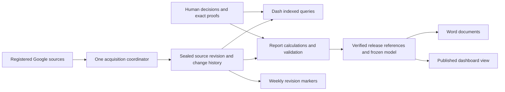

# Architecture

Last broad overview: 2026-06-04. Source/storage paths below rechecked: 2026-10-12 (Kamchatka).

## Layers

```text
Google Sheets
  -> packages/server services/google-sheets.ts
  -> packages/core pipeline and analytics
  -> packages/server snapshot + API routes
  -> packages/web React UI
```

## Packages

- `@aemr/shared`: shared domain types, constants, legal thresholds, dictionaries and rule book.
- `@aemr/core`: pure calculation layer: ingestion helpers, normalization, signal detection, reconciliation, analytics, trust scoring.
- `@aemr/server`: Fastify API, Google Sheets access, SQLite persistence, snapshot orchestration and auth.
- `@aemr/web`: React SPA, global Zustand store, filters, pages and charts.

## Server Runtime

`packages/server/src/index.ts` starts the app. `packages/server/src/app.ts` owns app creation and route registration so tests can instantiate the server without binding a port.

Registered route groups:

- `/api/dashboard`, `/api/refresh`
- `/api/metrics`
- `/api/audit`
- `/api/rows`
- `/api/issues`
- `/api/mapping`
- `/api/journal`, `/api/sources/*`
- `/api/settings`
- `/api/analytics`
- `/api/health`

`/api/debug/sheets` is registered only outside production.

## Auth Boundary

`registerAuthHook` protects `/api/*` when `AEMR_API_KEY` is set. In production the server refuses to start without this key. `/api/health` is public.

The web client sends `Authorization: Bearer <key>` from `localStorage.aemr_api_key`.

## Data Sources

The main spreadsheet ID comes from `GOOGLE_SHEETS_SPREADSHEET_ID` or the shared default constant. Department spreadsheet defaults live in `packages/server/src/config.ts`; runtime overrides are saved in `data/sources.json`.

`ШДЮ` (месячный свод) на текущем серверном пути читается отдельно: `fetchSHDYUSheet(SHDYU_SPREADSHEET_ID)` → `parseSHDYUSheet()` → `snapshot.shdyuData`. В `pipelineInput.sheetRows` для `runPipeline()` он не добавляется. `ALL_SHEETS` основной книги включает `СВОД ТД-ПМ` и листы ГРБС, а не месячный ШДЮ. Это подтверждено проверкой `snapshot.ts` на 2026-10-10 (см. [верифицированный аудит](superpowers/audits/2026-10-10-dash-code-review-verified/README.md), DASH-011).

Production source classification is documented in [DATA_SOURCES.md](DATA_SOURCES.md). Metric-level traceability from sheet columns to API DTO and UI labels is documented in [METRICS_CONTRACT.md](METRICS_CONTRACT.md).

## Database

Current implementation is SQLite through `better-sqlite3`. Drizzle schema tables include snapshots, metric history, issues, issue history, audit log, input errors, mapping overrides and procurement rows.

Production compose persists SQLite at:

```text
/app/packages/server/data/aemr.db
```

## Web Runtime

Top-level pages:

- Dashboard
- DataBrowser
- Economy
- Quality, with tabs for Trust, Recon, Issues, Recs, Journal
- Analytics
- Settings

Global state lives in `packages/web/src/store.ts`. Filter semantics: empty Set means "all"; period can be week-derived or explicit month/quarter/year selection.

## 44-FZ Thresholds

Canonical 44-ФЗ numeric thresholds are in `packages/shared/src/constants.ts` under `LAW_44FZ_THRESHOLDS`. Core analytics and signals should import those constants instead of duplicating numbers.


## Source versions and report storage — current and target

The operational Dash reader and Python report worker currently acquire Google
sources independently. Dash persists complete PipelineSnapshot JSON plus SQL
row/metric projections; Python persists snapshot payloads, one ReportModel and
several JSON projections, then PublicationStore copies the candidate directory.
The published Python dashboard projection is verified against its ReportModel;
this does not establish version parity with all live Dash routes.

Target: one sealed source revision used by both consumers; unchanged content
stored once, changes and bounded recovery checkpoints retained, weekly markers
referencing completed revisions in Asia/Kamchatka. A verified release references
that revision, rules/renderer versions and one frozen model. Derived views use
indexed current state or bounded caches; they do not retain new full source
copies per release. Human decisions and their minimal exact proofs survive GC.
The current live head may be newer than the verified release; consumers expose
both explicitly instead of silently changing historical document input.



This is a transition design, not deployed behavior. It does not move independent
Operational Tasks or OKRUG production data into Dash. See the existing
[ADR-001 revision](decisions/0001-verified-report-publication.md) for current
byte measurements, alternatives, migration stages, failure handling and tests.
PostgreSQL selection remains C08; changing the database alone cannot remove
application-level snapshot duplication or unify acquisition.
