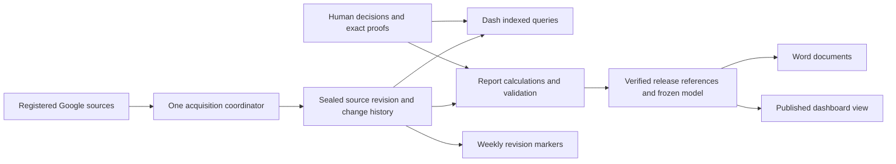

# Architecture

Last broad overview: 2026-06-04. Source/storage paths below rechecked: 2026-10-12 (Kamchatka).

## Уточнение цели 16.10.2026

Архитектура должна локализовать изменения. Адаптер нового источника не
переписывает математику, новый показатель не требует смены хранилища, новый
экран не копирует расчёт. Технические версии обеспечивают воспроизводимость;
это не параллельные продукты. Единственный план и приёмка остаются в
[PLAN](PLAN.md) и [#69](https://github.com/gaben1488/dash/issues/69).

Выбран путь модульного монолита с существующим Word-worker. Ближайшая поставка
и переход к общему входу разделены в [ADR-001](decisions/0001-verified-report-publication.md).
Общий вход ещё не внедрён: TypeScript Dash и Python worker сейчас получают
источники независимо. Совпадение проекции одного ReportModel не доказывает
совпадение всех live-экранов с ним.

| Логическая граница | Существующее размещение | Условие целевого перехода |
|---|---|---|
| Первичные источники | server Google services; report-engine Google adapter | Один состав/профиль/ревизия приобретения; буквы колонок остаются на границе |
| Нормализация, валидация, происхождение | core ingestion; Python raw pipeline и source proof | Одна текущая типизированная модель; история через ограниченные adapters |
| Сущности, связи, история | identity store, procurement rows, expert decisions | Потребность/план/процедура/контракт/исполнение не сплющены; похожесть не identity |
| Правила и показатели | shared/core; report-engine rules и independent audit | Общие определения, единицы, период и зависимости; сравнение на одном input |
| Прикладные операции | Fastify routes, worker, publication store | Явные ACK/readback/idempotency и конечные состояния; отказ выпуска не restart API |
| BI, документы, компоненты | 13 web-разделов, Design Lab, DOCX renderer | Один компонент/селектор для preview и production; Word и BI на одном контексте |
| Хранение и эксплуатация | SQLite, source bundles, reader leases, deploy/systemd | Содержимое по отпечатку отдельно от наблюдений; restore/rollback/GC по ссылкам |

Таблица задаёт границы перехода, а не утверждает, что все они уже реализованы.
PostgreSQL остаётся отдельным решением C08: сначала замеры запросов, конкуренции,
пикового scratch и восстановления. Текущие source-read timeout и повторное
сохранение больших JSON не доказывают ограничение SQLite. Новые брокеры,
микросервисы и дополнительные базы без измеренной необходимости не вводятся.

Повторное чтение, одинаковые байты и идентичность закупки учитываются отдельно.
Наблюдение хранит фактическую provider revision, время/полноту/профиль и ссылку
на содержимое. Переиспользование результата зависит также от правил,
нормализации, календаря, шаблона и доступа. Авторство не выводится из времени
импорта. При исчезновении строки сравниваются пригодный live и последний
подтверждённый четверг Asia/Kamchatka, с сохранением обеих точек и неопределённости.

### Проверяемый ближайший переход, 16.10.2026

[ADR0012](decisions/0012-bounded-dashboard-read-model.md) отделяет обычное HTTP
чтение готовой модели от импорта. `ccbd4213` реализует background materialization,
строгий scope, исходное время и явную freshness. Следующее изменение добавляет
метаданный expression index, чтобы отсутствие нужного года не требовало разбора
JSON всей истории. Это не общий канонический вход и не доказательство полной
миграции. На production до новой установки остаётся83b813ab.

Конкурирующие объяснения проверены разными материалами: deferred Google test
доказал coupling импорта/GET; SQLite expression counter и контроль без индекса
доказывают стоимость поиска в истории; live frozen diagnostic отделил сохранённые
unknown:REF от потери registered payload. Последний отказ не исправляется заменой
БД. Изменение qualification для исторического отказа отдельно обосновано в
[ADR0010](decisions/0010-canonical-weekly-report-archive.md); исходный FAIL и
непринятое переиздание сохраняются. Свежая установка/измерения ещё обязательны.

Следующая предметная вертикаль остаётся прежней: один зафиксированный вход →
официальная экономия → API/BI/Word, плюс общая проекция человеческих решений
для дела/показателей/журнала. Пригодность границ проверяется изменением адаптера
и правила на изолированном наборе, независимым пересчётом и сохранностью старых
результатов. Простое совпадение старого и нового API не является независимым
расчётом. До этой проверки гибкость всей системы не объявляется доказанной.

## Layers

```text
Google Sheets
  -> packages/server services/google-sheets.ts
  -> packages/core pipeline and analytics
  -> packages/server snapshot + API routes
  -> packages/web React UI
```

## Packages

- `@aemr/shared`: shared domain types, constants, legal thresholds, dictionaries and rule book.
- `@aemr/core`: pure calculation layer: ingestion helpers, normalization, signal detection, reconciliation, analytics, trust scoring.
- `@aemr/server`: Fastify API, Google Sheets access, SQLite persistence, snapshot orchestration and auth.
- `@aemr/web`: React SPA, global Zustand store, filters, pages and charts.

## Server Runtime

`packages/server/src/index.ts` starts the app. `packages/server/src/app.ts` owns app creation and route registration so tests can instantiate the server without binding a port.

Registered route groups:

- `/api/dashboard`, `/api/refresh`
- `/api/metrics`
- `/api/audit`
- `/api/rows`
- `/api/issues`
- `/api/mapping`
- `/api/journal`, `/api/sources/*`
- `/api/settings`
- `/api/analytics`
- `/api/health`

`/api/debug/sheets` is registered only in explicitly declared development/test runtimes.

## Auth Boundary

`registerAuthHook` protects `/api/*` when `AEMR_API_KEY` is set. In production the server refuses to start without this key. `/api/health` is public.

Production browser access uses Caddy Basic authentication; Caddy injects the
server-side Bearer token. The production web client deliberately does not send
`localStorage.aemr_api_key` (see `web/src/api.ts`). Direct development API access
can use that local key. This is coarse service access, not proof of per-user or
per-organization authorization; the target roles in PRODUCT.md are not an
implemented permissions model.

## Data Sources

The main spreadsheet ID comes from `GOOGLE_SHEETS_SPREADSHEET_ID` or the shared default constant. Department spreadsheet defaults live in `packages/server/src/config.ts`; runtime overrides are saved in `data/sources.json`.

`ШДЮ` (месячный свод) на текущем серверном пути читается отдельно: `fetchSHDYUSheet(SHDYU_SPREADSHEET_ID)` → `parseSHDYUSheet()` → `snapshot.shdyuData`. В `pipelineInput.sheetRows` для `runPipeline()` он не добавляется. `ALL_SHEETS` основной книги включает `СВОД ТД-ПМ` и листы ГРБС, а не месячный ШДЮ. Это подтверждено проверкой `snapshot.ts` на 2026-10-10 (см. [верифицированный аудит](superpowers/audits/2026-10-10-dash-code-review-verified/README.md), DASH-011).

Production source classification is documented in [DATA_SOURCES.md](DATA_SOURCES.md). Metric-level traceability from sheet columns to API DTO and UI labels is documented in [METRICS_CONTRACT.md](METRICS_CONTRACT.md).

## Database

Current implementation is SQLite through `better-sqlite3`. Drizzle schema tables include snapshots, metric history, issues, issue history, audit log, input errors, mapping overrides and procurement rows.

Production compose persists SQLite at:

```text
/app/packages/server/data/aemr.db
```

## Web Runtime

Текущие 13 разделов в `packages/web/src/App.tsx` и Header:

- Пульс (`dashboard`), Отчёт (`report`), Свод (`svod`).
- Реестр (`data`), Не обеспеченные (`unfunded`), В течение года (`yearlong`), Мониторинг (`monitoring`).
- Экономия (`economy`), Конкуренция (`competition`), Дисциплина (`discipline`), Аналитика (`analytics`).
- Контроль (`quality`) и Система (`settings`).

Исторические `recon/trust/issues/recs/journal` читаются как пути Контроля;
это не дополнительные независимые расчётные экраны. Перечень исходников
не является приёмкой всех 13 браузерных сценариев.

Global state lives in `packages/web/src/store.ts`. Filter semantics: empty Set means "all"; period can be week-derived or explicit month/quarter/year selection.

## 44-FZ Thresholds

Canonical 44-ФЗ numeric thresholds are in `packages/shared/src/constants.ts` under `LAW_44FZ_THRESHOLDS`. Core analytics and signals should import those constants instead of duplicating numbers.


## Source versions and report storage — current and target

The operational Dash reader and Python report worker currently acquire Google
sources independently. Dash persists complete PipelineSnapshot JSON plus SQL
row/metric projections; Python persists snapshot payloads, one ReportModel and
several JSON projections, then PublicationStore copies the candidate directory.
The published Python dashboard projection is verified against its ReportModel;
this does not establish version parity with all live Dash routes.

Target: one sealed source revision used by both consumers; unchanged content
stored once, changes and bounded recovery checkpoints retained, weekly markers
referencing completed revisions in Asia/Kamchatka. A verified release references
that revision, rules/renderer versions and one frozen model. Derived views use
indexed current state or bounded caches; they do not retain new full source
copies per release. Human decisions and their minimal exact proofs survive GC.
The current live head may be newer than the verified release; consumers expose
both explicitly instead of silently changing historical document input.



This is a transition design, not deployed behavior. It does not move independent
Operational Tasks or OKRUG production data into Dash. See the existing
[ADR-001 revision](decisions/0001-verified-report-publication.md) for current
byte measurements, alternatives, migration stages, failure handling and tests.
PostgreSQL selection remains C08; changing the database alone cannot remove
application-level snapshot duplication or unify acquisition.
